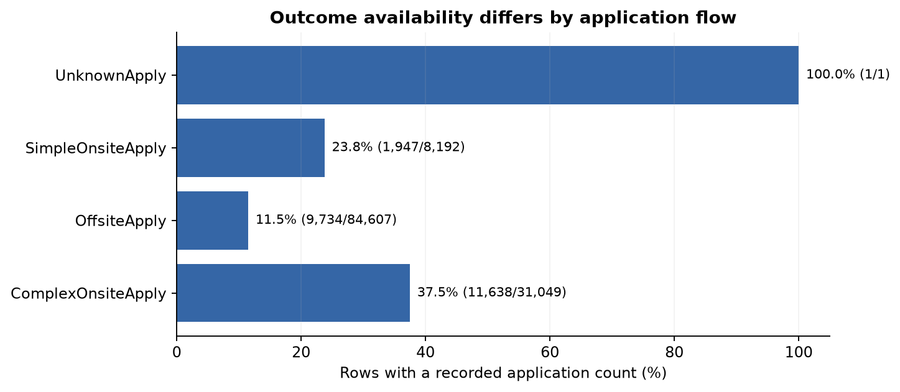
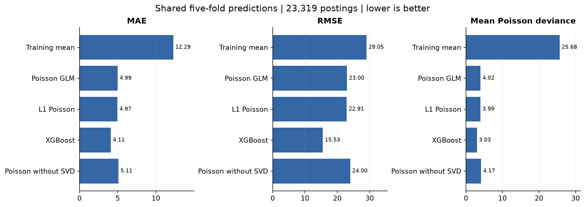
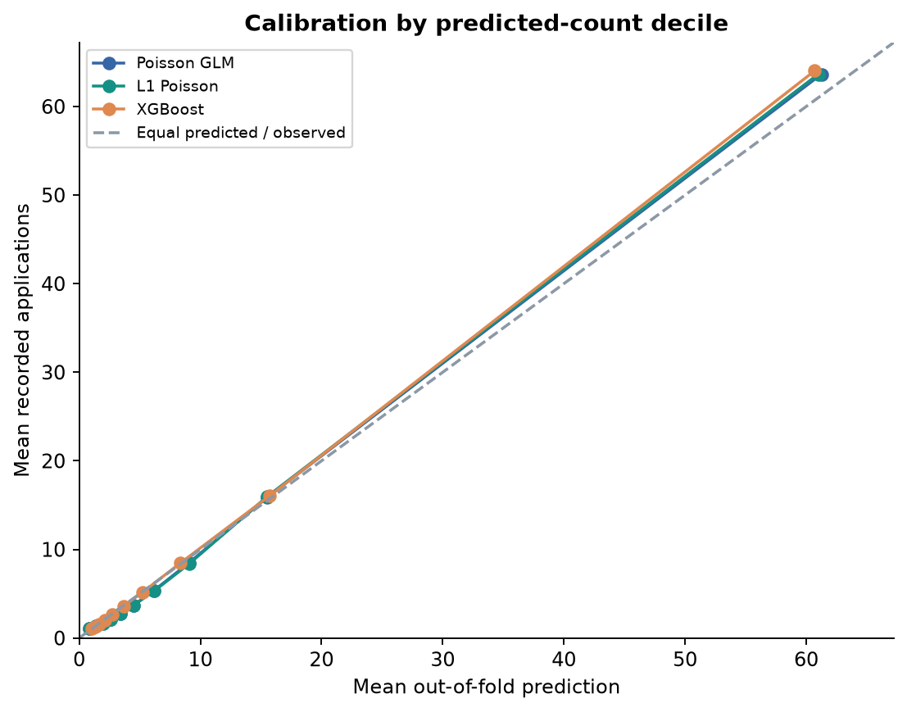

# Recorded LinkedIn Job Applications

Source-audited reanalysis of a December 2025 course project. Revision: October 8, 2026.

SOURCE-AUDITED REANALYSIS | OCTOBER 8, 2026

Junwei Lu | Reconstruction of the December 2025 course project

This report replaces unsupported numerical comparisons and exposure interpretations in the earlier report and presentation. It reconstructs the analysis from a recovered original input; it is not an exact replay of the historical execution state.


## Executive findings

The recovered Kaggle file contains 123,849 unique job postings. Only 23,319 (18.8%) have both recorded applications and views. Every observed application count is positive. The analysis therefore describes a selected subset, with substantial uncertainty about missing outcomes.

Three count-mean models were evaluated on the same five held-out folds. XGBoost had the lowest MAE, RMSE and mean Poisson deviance. XGBoost MAE was 4.106, a 66.6% reduction against the training-mean baseline on this selected sample.

The description SVD comparison changed Poisson MAE by 2.40% relative to the same feature set without SVD (positive means improvement). Title keywords and text length remain in both models. The experiment isolates this particular description representation, not the value of all text information.

Views is a concurrent measurement and enters the primary model with a learned coefficient. Predictions describe recorded counts conditional on observed visibility; they are not forecasts available before a job is posted. Expiry dates do not provide a verified observation duration.

| Evidence | Scope |
| --- | --- |
| 123,849 raw rows / 23,319 analyzed | Outcome and views jointly observed |
| Five shared outer folds | Held-out postings within this collection |
| Full-sample coefficient intervals | Company-cluster robust, descriptive associations |
| Reproducible code and saved predictions | Pinned input fingerprint, fold-level preprocessing, independent metric checks |

The results do not identify causal effects, completed applications across every flow, zero-application behavior, or performance on future postings and unseen employers.


## 1. Data provenance and analysis population

Input: Arsh Koneru's LinkedIn Job Postings (2023-2024), Kaggle version 13, released August 19, 2024. The recovered archive member has 31 columns and 516,843,769 bytes, matching the version-13 file manifest. Its local SHA-256 is pinned in the downloader and data audit. A remote cryptographic hash was not supplied by the inspected manifest, so the version match rests on provenance and matching file size.

| Selection step | Rows |
| --- | --- |
| Original rows / unique job IDs | 123,849 |
| Missing recorded application count | 100,529 |
| Observed valid application count | 23,320 |
| Excluded: missing/invalid views among those rows | 1 |
| Common modeling population | 23,319 |
| Observed zero application counts | 0 |

The earlier working CSV has 124,802 rows and 51 columns, including 33 unnamed headers, field displacement and duplicate records. It is not the verified original. The corrected pipeline starts from the intact archive, preserves job IDs, checks duplicate grain and validates observed counts.



The collector code inspected for provenance drops false-like values, including zero. This could explain some missing counts, but the exact collector revision for every row is unknown. Missing outcomes are not globally imputed to zero. Missing remote flags remain Unknown rather than being called verified onsite jobs.


## 2. Measurement and statistical design

The response is the recorded `applies` field. LinkedIn's official descriptions distinguish completed applications from external apply clicks. Those definitions expose a measurement risk but do not prove the precise historical meaning of every record. Cross-flow coefficients can reflect measurement differences as well as applicant behavior.

For the Poisson GLM, log E[Y | X, observed Y and views] = intercept + beta_views * log(1 + views) + X beta. The main offset is zero. The Poisson loss is used as a working count-mean objective; the selected positive outcomes are not asserted to follow a standard Poisson distribution. Company-cluster robust intervals describe full-sample associations, conditional on the constructed features.

| Component | Implementation |
| --- | --- |
| Predictors | Application flow, work type, experience, remote flag, region, rule-based title categories, salary band, title/description lengths, title keywords, description SVD, log1p views. |
| Description features | Training-only TF-IDF, at most 1,500 unigram/bigram terms; 15 SVD components. SVD axes are algebraic summaries, not validated semantic topics. |
| Learned transformations | Vocabulary, SVD, salary quantiles, rare-category pooling and feature availability fitted within each training split. Fixed text rules use no outcome. |
| Outer evaluation | Five shuffled posting-level folds, seed 20251201. Saved row IDs and identical test sets for all primary models. |
| Inner selection | One 20% training-only holdout per outer fold. L1 alpha from 0.001, 0.01, 0.1, 1.0; XGBoost early stopping, maximum 800 rounds. Preprocessing is refitted on inner training. |
| Model fitting | Unpenalized Poisson GLM, genuine L1 Poisson, and XGBoost count:poisson. All include learned log views; no held-out outcome tunes the outer fit. |
| Metrics | Pooled out-of-fold MAE, RMSE and mean Poisson deviance. Deviance sum is also saved; all comparisons use a stated denominator. |

Random posting folds can contain the same company and similar descriptions in training and test sets. They measure interpolation within this collection. Company-grouped and temporal validation were not performed, and group-robust coefficient intervals do not fix this prediction-validation limitation.

Primary ablation removes description SVD only. Sensitivity specifications fix the views coefficient at one, or additionally impose the earlier duration proxy. A companion learned-views model is evaluated on exactly the same duration-eligible subset.


## 3. Held-out model performance

| Model | N | MAE | RMSE | Mean deviance |
| --- | --- | --- | --- | --- |
| Training-mean baseline | 23,319 | 12.288 | 29.048 | 25.681 |
| Proportional (views + 1) baseline | 23,319 | 6.326 | 33.191 | 5.931 |
| Poisson GLM | 23,319 | 4.987 | 23.004 | 4.018 |
| L1 Poisson | 23,319 | 4.974 | 22.906 | 3.993 |
| XGBoost | 23,319 | 4.106 | 15.530 | 3.026 |
| Poisson without description SVD | 23,319 | 5.110 | 24.005 | 4.175 |



XGBoost reduces MAE by 66.6% relative to a constant training-mean prediction. This is a measured predictive comparison, not an improvement in real application volume. The best primary model by MAE is XGBoost; metrics can rank models differently because large errors receive different weights.

With description SVD, Poisson MAE is 4.987; without SVD it is 5.110. The corresponding mean deviances are 4.018 and 4.175. No formal uncertainty interval for the performance difference was estimated; this is a single, reproducible split design.

Final descriptive fits use the median of the inner-selected hyperparameters: L1 alpha 0.01, XGBoost 571 rounds. Outer test losses are not used to select these final settings. Full-sample fits do not replace held-out scores.


## 4. Conditional associations and interpretation

| Term | Count ratio | 95% cluster CI |
| --- | --- | --- |
| application_type__ComplexOnsiteApply | 1.324 | [1.213, 1.445] |
| application_type__SimpleOnsiteApply | 1.316 | [1.194, 1.452] |
| formatted_work_type__Contract | 0.958 | [0.901, 1.019] |
| formatted_work_type__Part-time | 0.942 | [0.801, 1.107] |
| kw_python | 1.032 | [0.936, 1.138] |
| kw_sql | 1.446 | [1.278, 1.637] |
| kw_java | 1.431 | [1.303, 1.572] |
| log1p_views | 2.540 | [2.447, 2.636] |

Application-flow references are OffsiteApply; work-type references are Full-time. Keyword indicators mean presence in the title, not verified applicant skills or all text mentions. All contrasts hold included features fixed. Full-time is a reference category, so a general claim that full-time roles outperform every alternative requires checking each contrast rather than reading a single coefficient.

Both recorded onsite-flow contrasts exceed one, but differences in event measurement and outcome availability prevent a causal interpretation. Contract and Part-time intervals include one, as do Internship and Temporary work types in the complete table. The earlier broad claim that full-time roles consistently attract stronger responses is therefore unsupported.

SQL and Java title indicators have positive conditional associations in this specification. Python's interval includes one. The earlier broad claim about explicit technical skill signals should be narrowed to the specific measured title indicators and qualified as an exploratory association.

The fitted log1p-views coefficient is 0.932 (95% cluster-robust interval 0.895 to 0.969). It is an elasticity with respect to views + 1. The exponentiated coefficient instead describes multiplying views + 1 by e; it is not the effect of one additional view.

The full Poisson fit contains 73 parameters across 10,968 company/missing-ID clusters. Its Pearson dispersion statistic is 3.57, showing why naive Poisson standard errors should not be treated as adequate. The robust calculation is independently checked against a separate implementation.

These intervals are nominal and are not adjusted for screening many terms or for uncertainty in learned text features. They support cautious descriptive reporting, not confirmatory causal claims. The complete coefficient table and reference levels are supplied alongside the selected terms.


## 5. Sensitivity, calibration and model reliance

| Specification | N | MAE | RMSE | Mean deviance |
| --- | --- | --- | --- | --- |
| Learned views, primary | 23,319 | 4.987 | 23.004 | 4.018 |
| Fixed views coefficient = 1 | 23,319 | 4.984 | 26.191 | 4.119 |
| Learned views, duration-eligible | 23,319 | 4.987 | 23.004 | 4.018 |
| Legacy duration x views proxy | 23,319 | 6.083 | 29.732 | 6.025 |

The legacy proxy uses the earlier of valid closure and expiry minus listing time, clipped to at least one day when the interval is positive. This deterministic interval can extend beyond the moment counts were captured. It is a stress test of an assumption, not recovered observed time at risk. Compare its result with the matched-subset learned-views row.



Decile calibration is a coarse diagnostic and may conceal poor predictions in tails or subgroups. Feature importance is supplied separately as normalized average split gain for the full-sample XGBoost fit. This describes model reliance, is sensitive to correlated predictors, and does not estimate intervention effects.


## 6. Corrections, limits and practical use

| Earlier issue | Correction |
| --- | --- |
| Damaged working CSV | Use the checksum-pinned original archive; retain job IDs and validate grain. |
| Unverified exposure adjustment | Learn the log-views coefficient; show fixed exposure assumptions as sensitivities. |
| Text preprocessing before evaluation | Fit text and category transformations separately inside every training split. |
| Inconsistent metric aggregation | Save each OOF prediction and recompute pooled metrics independently with the same denominator. |
| Overstated feature claims | State category references, robust uncertainty and measurement/selection limits. Avoid causal wording. |
| Mixed report/PPT result versions | Generate this report from the same result files used by the notebook and figures. |

The collection has no documented probability sampling design. Missing outcomes may combine absent measurements and omitted zeros. Application-flow measurement may differ. Job-level capture times are unavailable. Salary values contain implausible extremes; training-derived bands reduce their numeric leverage but do not validate the salary source. All sponsored flags in this input are zero, so a sponsorship effect cannot be estimated.

A defensible use is retrospective reporting: audit missingness by flow, compare model errors on a common population and identify descriptive associations for further investigation. Recruiting teams would need verified completed-application tracking, capture timestamps, group/time validation and an intervention design before using these coefficients to prescribe posting changes.

The original course work included R, Python cleaning and notebooks. The reconstructed modeling pipeline is implemented in Python to provide a single executable environment. It retains the three model families but changes damaged inputs and invalid evaluation choices. SQL is not claimed as a demonstrated component because no supporting SQL workflow was recovered.

Next validation priorities are: recover observation timestamps and zero outcomes, reconcile event definitions by application flow, test future-date and company-disjoint splits, and evaluate robustness to alternative feature specifications. These are remaining research tasks, not completed validations.


## 7. Reproducibility and sources

Repository: https://github.com/Junwlu/linkedin-job-posting-analytics

Use Python 3.11. Create a virtual environment, install the pinned analysis environment and project extras, verify the source file, run the pipeline, then regenerate the report and notebook. Full commands and platform notes are in README.md. The raw data, processed descriptions and serialized model remain outside Git.

```bash
python scripts/download_data.py
```

```bash
python -m linkedin_analytics --data data/raw/postings.csv
```

```bash
python scripts/build_report.py
```

```bash
python scripts/build_notebook.py --execute
```

```bash
python -m pytest -q
```

Independent validation recomputes pooled and fold-wise losses directly from saved predictions, checks positive finite predictions, unique row coverage, split alignment and paired sensitivity populations. Synthetic tests cover cleaning, training-only transforms, genuine L1 sparsity, offset semantics, covariance calculations, downloader safeguards and detection of corrupted result files.

Primary sources are linked below. Source-specific details and exact provenance evidence are expanded in docs/DATA_SOURCE.md. Dataset citation: Koneru, Arsh (2024), LinkedIn Job Postings (2023-2024), version 13, Kaggle; data card additionally credits @zoeyyuzou. Data and derived analytical outputs retain CC BY-SA 4.0 attribution; newly written code is MIT licensed.

- [Kaggle dataset and version history](https://www.kaggle.com/datasets/arshkon/linkedin-job-postings)
- [Collector schema and fixed source commit](https://github.com/arshka/LinkedIn-Job-Scraper/tree/62c2e559234fe7b5cff3d902ccda9cea2d069c63)
- [LinkedIn applicant definitions](https://www.linkedin.com/help/talent-insights/answer/a563146)
- [LinkedIn recruiter reporting definitions](https://www.linkedin.com/help/linkedin/answer/a413441)
- [Dataset license](https://creativecommons.org/licenses/by-sa/4.0/)
- [glum generalized linear model documentation](https://glum.readthedocs.io/en/latest/glm.html)
- [XGBoost objective documentation](https://xgboost.readthedocs.io/en/stable/parameter.html)
